# Only Search

Only Search is a home screen app for Android (a "launcher") built around one search bar. Type to find apps, contacts and settings, or to get instant answers: sums, unit conversions, currency conversions, dates and time zones. It comes in a dark and a light theme.

**Dark**

<p>
  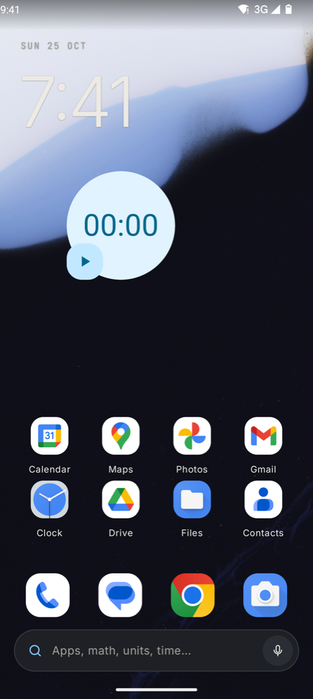
  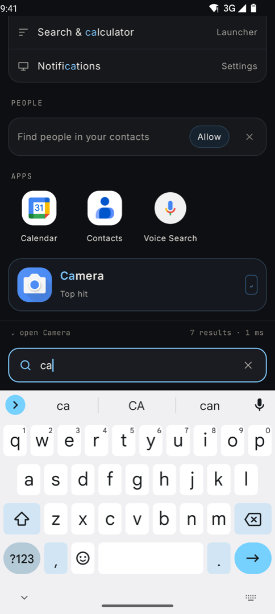
  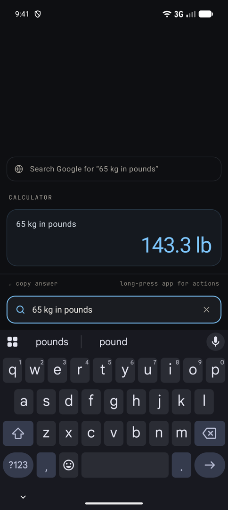
  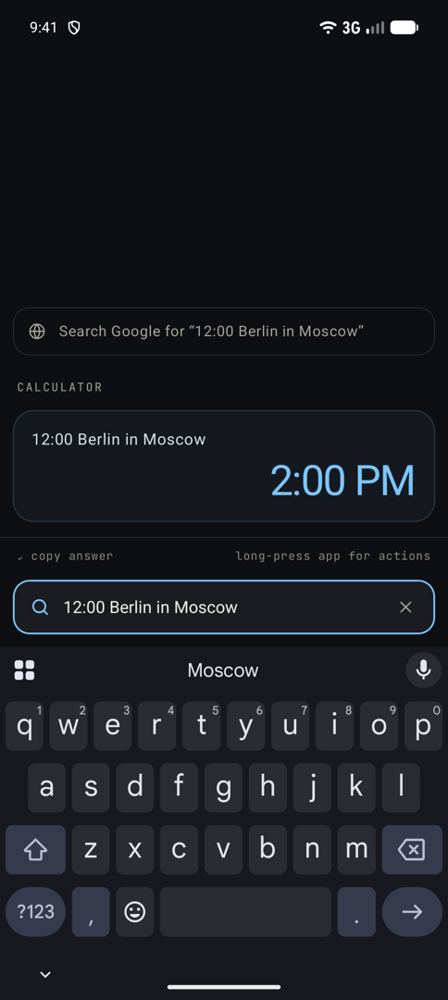
  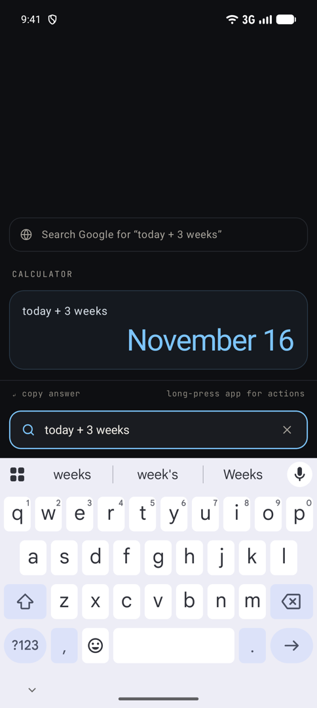
</p>
<p>
  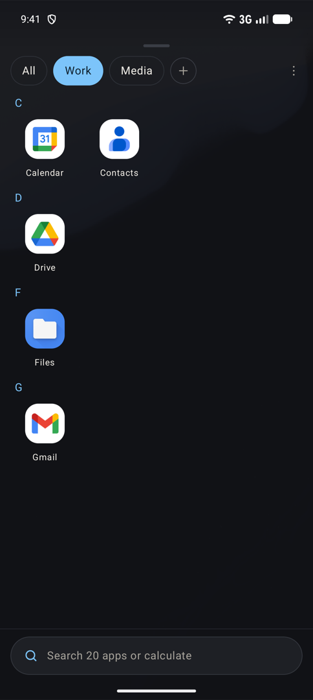
  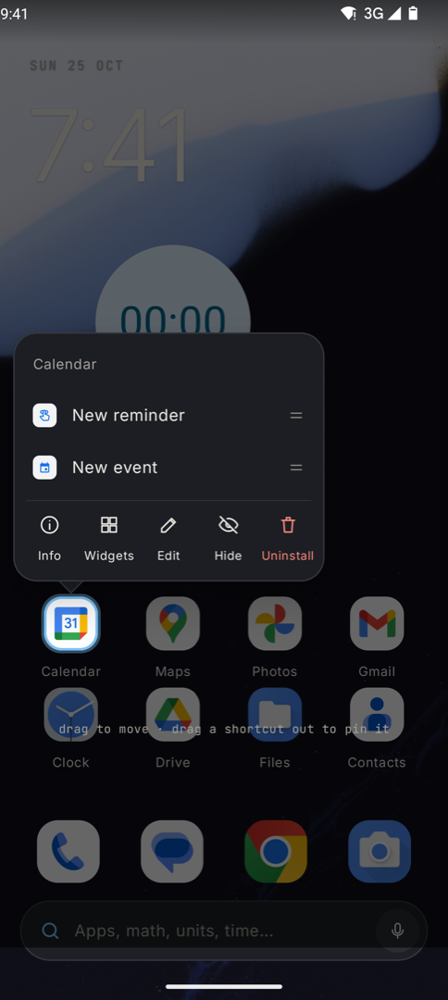
  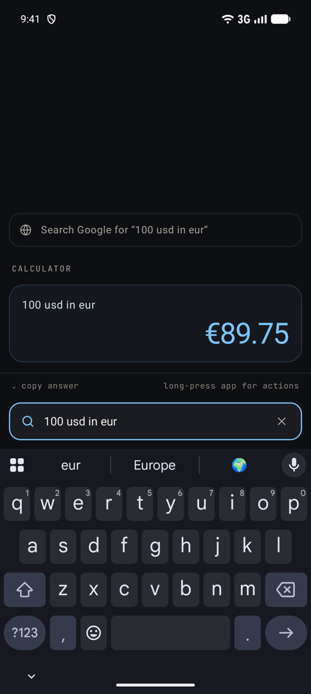
  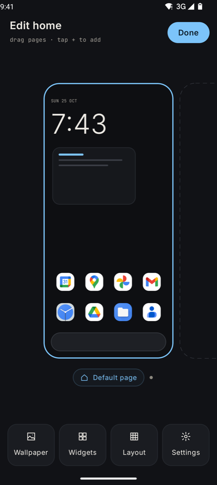
  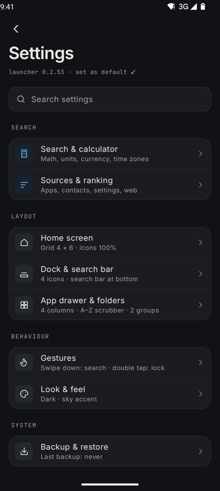
</p>
<p>
  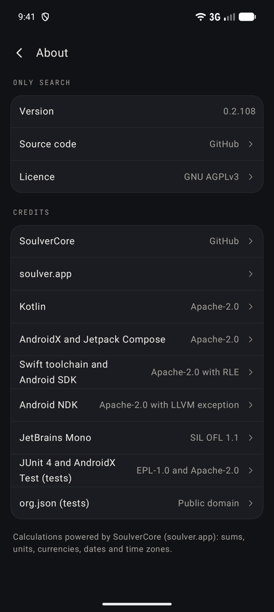
</p>

**Light**

<p>
  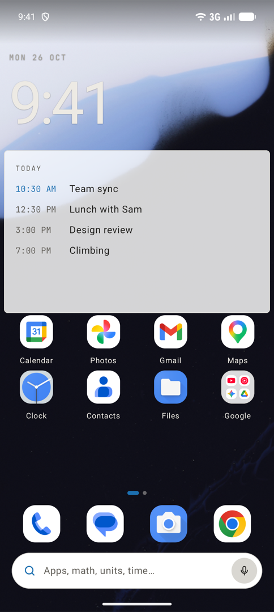
  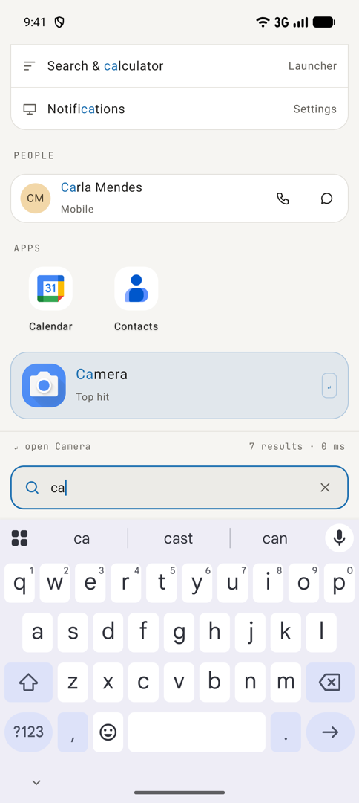
  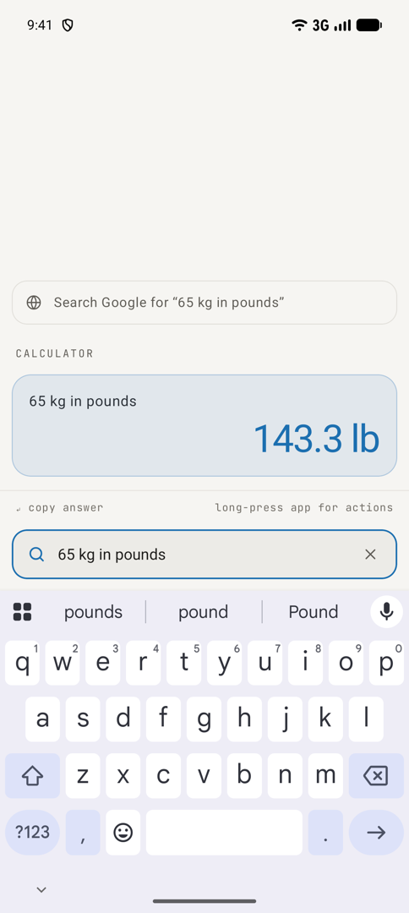
  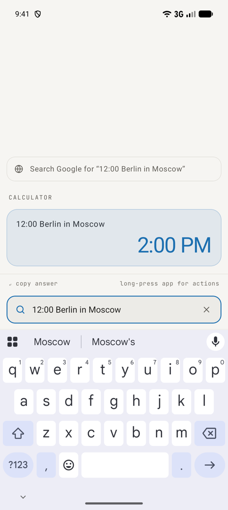
  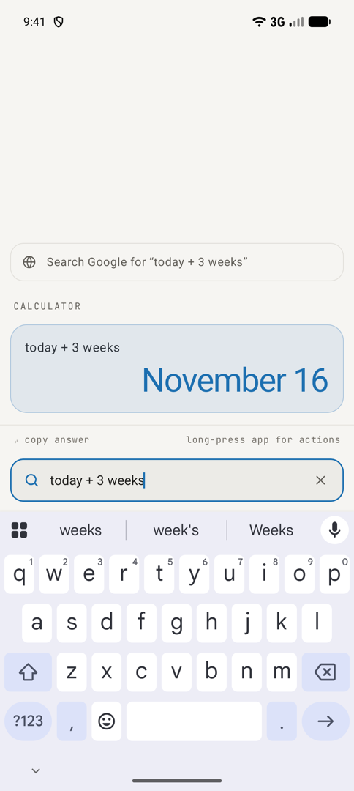
</p>
<p>
  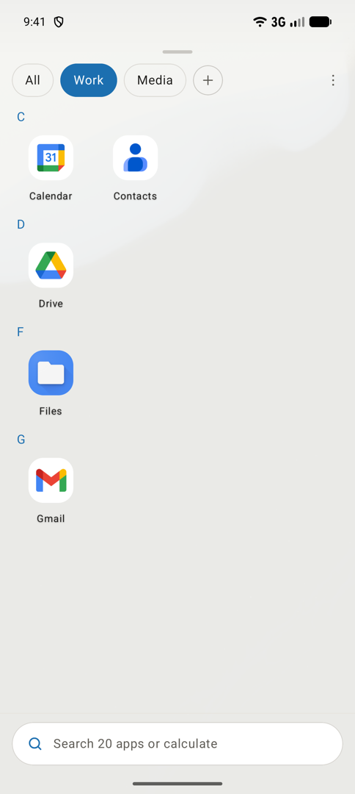
  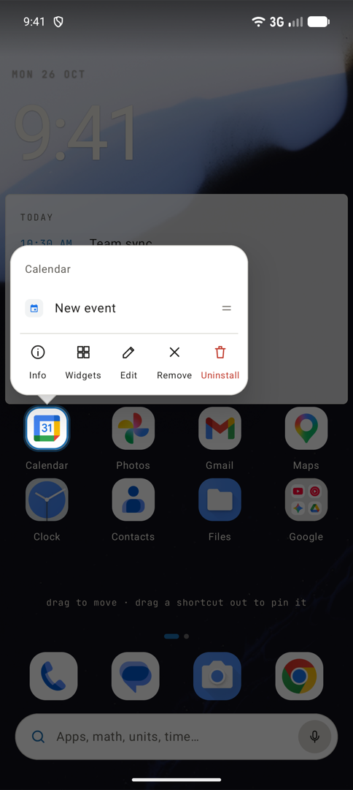
  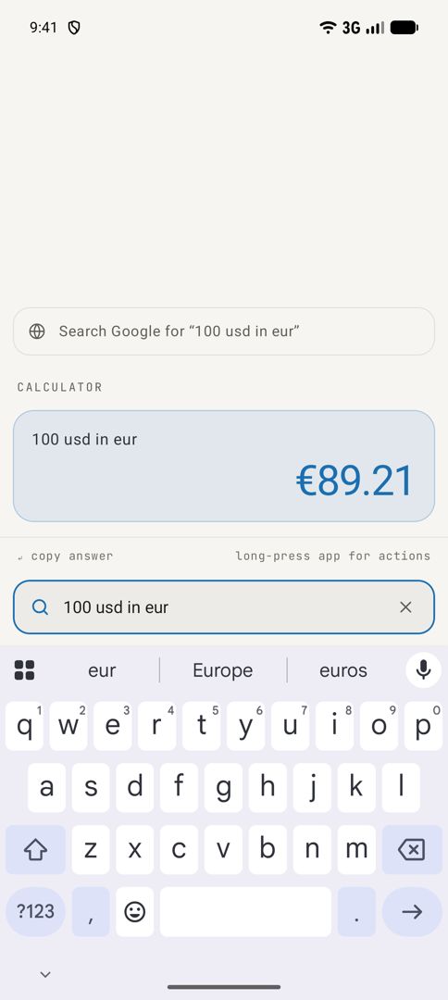
  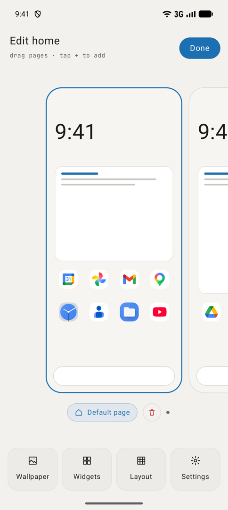
  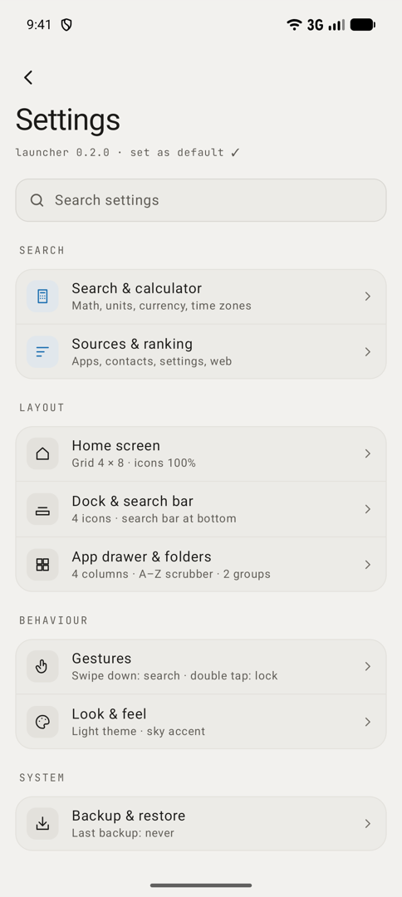
</p>
<p>
  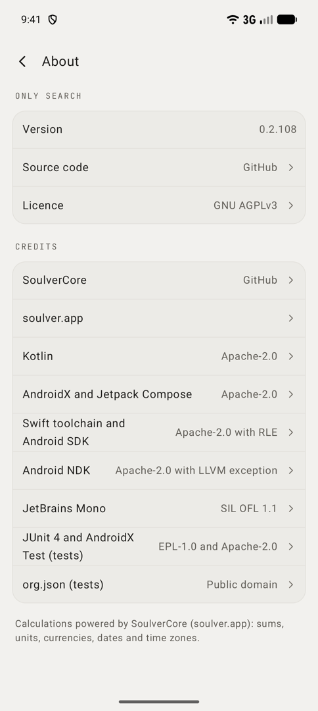
</p>

Left to right, top to bottom: home screen, search, a unit conversion, a time zone conversion, a date calculation, the app drawer, an app's menu, a currency conversion, editing home pages, settings, about.

## What it can do

**Search and calculate**
- Find apps, app shortcuts, contacts, phone settings and the web from one box. Press the enter key to open the top result.
- Type a sum, a percentage or a conversion and the answer appears as you type. A few things to try:
  - Maths and percentages: `(128*3.5)/4 + 12^2`, `20% of 340`, `$48 + 15% tip`
  - Units: `65 kg in pounds`, or just `5 ft` and it shows metres. Bare units convert to your home unit system (Settings, Search & calculator, Defaults).
  - Currencies and crypto (live rates): `12 USD` shows your home currency, `12 USD in GBP`
  - Time zones: `12:00 Berlin in Moscow`, `msk time`, `time in Tokyo`
  - 12 or 24 hour time: `1 pm` shows 13:00 when your phone uses a 24 hour locale
  - Dates and durations: `today + 1`, `tomorrow + 3 days`, `today + 3 weeks`, `12:00 + 1h 35m`
  - Decimals: `12.5` and `12,5` both mean 12.5 (a setting, on by default, under Defaults)
- Past calculations are kept in a history you can open again.

**Home screen**
- Several home pages with apps, folders and widgets on a grid. Drag things around, resize widgets, and keep your favourites in the dock.
- Calendar widgets: your next event, a list for today, and a full-page day timeline that draws events to scale. Each widget picks its own calendars.
- Long-press an app for its shortcuts, info, rename, hide or uninstall.
- Pinch in (or long-press the home screen and choose Edit home) to add, reorder or remove pages.

**App drawer**
- Frequently used apps at the top, your own groups, and an A to Z scrubber on the edge.

**Make it yours**
- Light or dark theme (Settings, Look & feel, Theme: System, Light or Dark), plus an optional pure black for OLED screens.
- Accent colours, icon shape and size, grid size, and where the dock and search bar sit.
- Icon packs, and themed icons that follow your accent colour (Android 13 or newer, for apps that provide them).
- Gestures: swipe up or down, two-finger swipe, double-tap, pinch or pressing Home can each open search, the drawer, notifications, settings and more. Locking the screen needs an optional accessibility permission, which Android asks for the first time you use it.

**Switching phones or launchers**
- Back up your whole setup to a file and restore it later.
- Import your layout from a Nova Launcher backup (see below).

## Privacy

- Contacts and calendar access are optional. Android asks only when a feature needs them, and the features work without them.
- The internet is used only to fetch currency rates.

## How to install

You need Android 9 or newer, on a modern phone (64-bit ARM, which is nearly every phone made in the last several years).

1. On your phone, open the [Releases page](https://github.com/MrModest/only-search/releases).
2. Under the newest release, download the file ending in `.apk`, named like `only-search-0.2.N-arm64.apk`.
3. Open the downloaded file. If Android says installing from this source is blocked, tap Settings, allow it for your browser or file manager, then go back and tap Install.
4. When it finishes, press the Home button. Android asks which home app to use: choose Only Search, then Always.

If Android doesn't ask, go to Settings, Apps, Default apps, Home app, and pick Only Search.

To go back to your old launcher, open the same Home app setting and choose it again. Uninstalling Only Search also works.

## Moving from Nova Launcher

1. In Nova Settings, use its backup option to save a `.novabackup` file, and keep it on your phone.
2. In Only Search, long-press the home screen and open Settings, then Backup & restore, then Import from Nova Launcher, and pick the file.
3. Confirm. Your home pages, dock, folders and drawer groups are replaced by Nova's, along with the settings that have a match. Widgets are added back one by one, and Android may ask to allow each. The launcher restarts when it's done.

## For developers

```sh
./setup.sh                                # once: pinned Swift toolchain, Swift SDK for Android, NDK
cd android && ./gradlew assembleRelease   # also builds the Swift bridge to SoulverCore
```

GitHub Actions (`.github/workflows/build.yml`) runs the same commands on every push and the emulator tests. `./local-build.sh [--install] [N]` builds a release-signed APK locally, fetching the key from 1Password. See [docs/ANDROID.md](docs/ANDROID.md) for the pipeline and [docs/DESIGN.md](docs/DESIGN.md) for the design.

## Credits

Calculations powered by **[SoulverCore](https://github.com/soulverteam/SoulverCore)** ([soulver.app](https://soulver.app)): sums, units, currencies, dates and time zones. Only Search uses the prebuilt Android libraries from [SoulverCore-Multiplatform](https://github.com/soulverteam/SoulverCore-Multiplatform).

Also used:

| Component | License |
|---|---|
| [Kotlin](https://github.com/JetBrains/kotlin) | Apache-2.0 |
| [AndroidX and Jetpack Compose](https://github.com/androidx/androidx) (core-ktx, activity-compose, Compose UI, foundation, Material 3, material-icons-core) | Apache-2.0 |
| [Swift](https://github.com/swiftlang/swift) toolchain, Swift SDK for Android and runtime libraries | Apache-2.0 with Runtime Library Exception |
| [Android NDK](https://github.com/android/ndk) (`libc++_shared.so`) | Apache-2.0 with LLVM exception |
| [JetBrains Mono](https://github.com/JetBrains/JetBrainsMono) font | SIL OFL 1.1 |
| [JUnit 4](https://github.com/junit-team/junit4) and AndroidX Test (tests only) | EPL-1.0 and Apache-2.0 |
| [org.json](https://github.com/stleary/JSON-java) (tests only) | Public domain |

Currency rates come from [open.er-api.com](https://open.er-api.com) and [CoinGecko](https://www.coingecko.com).

## License

Only Search is licensed under the GNU Affero General Public License v3.0, see [LICENSE](LICENSE).

Additional permission under GNU AGPL version 3 section 7: If you modify this Program, or any covered work, by linking or combining it with SoulverCore (or a modified version of that library), containing parts covered by the terms of the SoulverCore license, the licensors of this Program grant you additional permission to convey the resulting work.

This permission applies only to Only Search's own code. SoulverCore is not part of this project, is not covered by the AGPL, and stays under its own license from Soulver; no rights to it are granted here.

SoulverCore is a separate component under its own license, not covered by the AGPL. See its [license terms](https://github.com/soulverteam/SoulverCore/blob/master/LICENSE.md).
